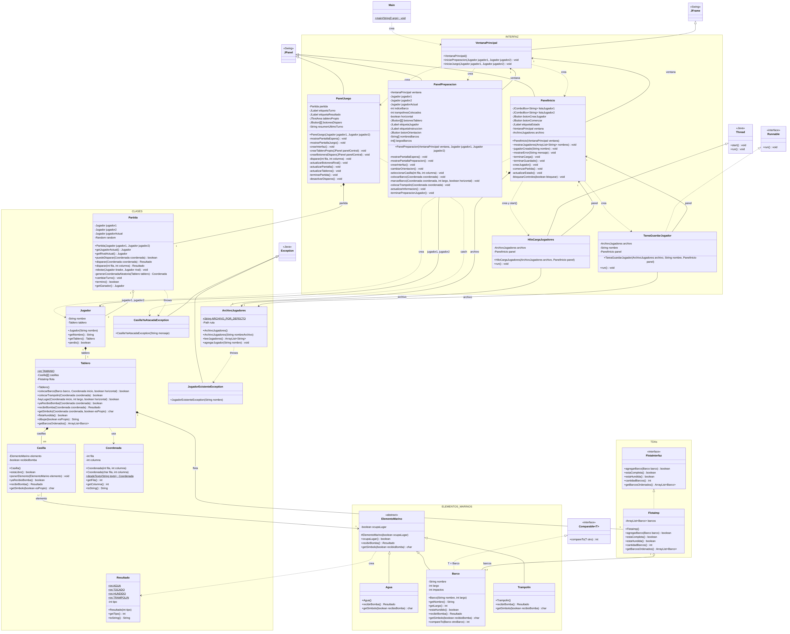

# Batalla Naval con Trampolines — Documento técnico

Paradigma Orientado a Objetos · UADE · 2.º cuatrimestre 2026

Este documento explica cómo está armado el juego: qué clases hay, cómo se conectan y dónde se aplican los temas pedidos en la guía del TP. Las reglas para jugar están en el manual, en esta misma carpeta ([`Manual_Batalla_Naval_con_Trampolines.docx`](Manual_Batalla_Naval_con_Trampolines.docx)).

- **Lenguaje:** Java, con interfaz gráfica Swing.
- **Idea central:** cada casilla guarda un `ElementoMarino` (agua, barco o trampolín) y cada uno responde a la bomba a su manera. Así el tablero nunca tiene que preguntar qué hay en una casilla.
- **Jugadores guardados:** al abrir el juego se elige un jugador de los ya guardados o se crea uno nuevo. Los nombres quedan en el archivo `jugadores.txt`, y el archivo se lee y se escribe en hilos separados para no congelar la ventana.

## Índice

1. [Estructura del repositorio](#1-estructura-del-repositorio)
2. [Diagrama de clases](#2-diagrama-de-clases)
3. [Diagramas de secuencia](#3-diagramas-de-secuencia)
4. [Patrón GRASP y principio SOLID](#4-patrón-grasp-y-principio-solid)
5. [Archivos, hilos y destructores](#5-archivos-hilos-y-destructores)

---

## 1. Estructura del repositorio

```text
paradigma-grupo5/
├── README.md
├── .gitignore
├── clase-02/ … clase-04/                 ejercicios de cada clase
└── TPO/
    ├── DOCUMENTO_TECNICO.md              este documento
    ├── Manual_Batalla_Naval_con_Trampolines.docx
    ├── diagramas/                        imágenes (.png) y fuentes Mermaid (.mmd)
    └── BATALLA_NAVAL/
        ├── Main.java                     punto de entrada: abre la ventana
        ├── INTERFAZ/                     Swing y los hilos que usa la pantalla de inicio
        │   ├── VentanaPrincipal.java
        │   ├── PanelInicio.java
        │   ├── PanelPreparacion.java
        │   ├── PanelJuego.java
        │   ├── HiloCargaJugadores.java
        │   └── TareaGuardarJugador.java
        ├── CLASES/                       lógica del juego
        │   ├── Partida.java
        │   ├── Jugador.java
        │   ├── Tablero.java
        │   ├── Casilla.java
        │   ├── Coordenada.java
        │   ├── Resultado.java
        │   ├── ArchivoJugadores.java
        │   ├── CasillaYaAtacadaException.java
        │   ├── JugadorExistenteException.java
        │   └── Consola.java              de la versión por consola; ya no se usa
        ├── ELEMENTOS_MARINOS/
        │   ├── ElementoMarino.java
        │   ├── Agua.java
        │   ├── Barco.java
        │   └── Trampolin.java
        └── TDAs/
            ├── FlotaInterfaz.java
            └── FlotaImp.java
```

Para correrlo: abrir la carpeta `paradigma-grupo5` en el editor y ejecutar `TPO/BATALLA_NAVAL/Main.java`. El archivo `jugadores.txt` se crea en la carpeta desde la que se ejecuta el juego (en VS Code, la carpeta abierta). Está en el `.gitignore` para que cada uno tenga sus propios jugadores.

## 2. Diagrama de clases



Fuente: [`diagramas/clases.mmd`](diagramas/clases.mmd).

Rombo lleno = composición (la parte no existe sin el todo). Rombo vacío = agregación. Triángulo con línea llena = herencia. Triángulo con línea punteada = implementa una interfaz. Flecha punteada = dependencia (crea, usa, lanza). `$` = `static`, `*` = abstracto, `#` = `protected`, `~` = default (sin modificador). `Consola` no aparece porque ya no la usa ninguna clase.

## 3. Diagramas de secuencia

### 3.1 Disparo con rebote en cadena

El jugador hace clic en una casilla del tablero rival. Si cae en un trampolín, la bomba rebota a una casilla al azar del tablero del que tiró; si ahí hay otro trampolín, vuelve al tablero rival, y así hasta que caiga en algo que no sea un trampolín.


Fuente: [`diagramas/secuencia_disparo.mmd`](diagramas/secuencia_disparo.mmd).

- El **alt** de arriba es la excepción propia `CasillaYaAtacadaException`: si ya se tiró en esa casilla, no se pierde el turno.
- En `elemento.recibirBomba()` está el polimorfismo (ver sección 4).
- El **loop** es la cadena de rebotes de `Partida.rebotar`.

### 3.2 Crear un jugador en un hilo separado


Fuente: [`diagramas/secuencia_crear_jugador.mmd`](diagramas/secuencia_crear_jugador.mmd).

- `PanelInicio` crea el hilo y llama a `start()`. Desde ahí, el guardado corre en paralelo y la ventana sigue respondiendo.
- Cuando el hilo termina, no toca la ventana directamente: le pide al hilo de Swing que lo haga con `SwingUtilities.invokeLater`.
- El `finally` garantiza que los botones se vuelvan a habilitar, haya salido bien o mal.

## 4. Patrón GRASP y principio SOLID

### GRASP — Polimorfismo

**Qué dice:** cuando un comportamiento cambia según el tipo de objeto, se le asigna a cada tipo con un método polimórfico, en vez de preguntar el tipo con `if` o `switch`.

**Dónde:** `ElementoMarino` (abstracta) y sus subclases `Agua`, `Barco` y `Trampolin`. Se usa en `Casilla.recibirBomba()` (está marcado con un comentario en el código):

```java
public Resultado recibirBomba() {
    recibioBomba = true;
    return elemento.recibirBomba();   // Agua, Barco o Trampolin: cada uno responde a su manera
}
```

**Qué ganamos:** la casilla no sabe qué tiene adentro. Si mañana se agrega un elemento nuevo (por ejemplo, una mina), alcanza con crear otra subclase de `ElementoMarino`; `Casilla` y `Tablero` no se tocan.

### SOLID — Principio de Responsabilidad Única (la "S")

**Qué dice:** una clase debe tener un solo motivo para cambiar.

**Dónde:** `ArchivoJugadores` (también marcado con un comentario en el código).

**Cómo se ve:** cada clase de la pantalla de inicio hace una sola cosa:

| Clase | Su única responsabilidad |
| --- | --- |
| `ArchivoJugadores` | Leer y escribir `jugadores.txt` |
| `PanelInicio` | Mostrar la pantalla y atender los botones |
| `HiloCargaJugadores` / `TareaGuardarJugador` | Hacer el trabajo con el archivo fuera del hilo de la ventana |

`PanelInicio` no sabe nada del archivo, y `ArchivoJugadores` no sabe nada de la ventana. Si mañana se cambia el formato del archivo, o se guarda en otro lugar, solo cambia `ArchivoJugadores`.

## 5. Archivos, hilos y destructores

### Archivo

`ArchivoJugadores` guarda un nombre por línea en `jugadores.txt` (UTF-8, para que funcionen tildes y eñes).

| Método | Qué hace |
| --- | --- |
| `leerJugadores()` | Devuelve un `ArrayList<String>` con los nombres. Si el archivo todavía no existe, devuelve la lista vacía. |
| `agregarJugador(nombre)` | Agrega el nombre al final del archivo (lo crea si no existe). Lanza `JugadorExistenteException` si ese nombre ya estaba, sin importar mayúsculas. |

Los dos declaran `throws IOException`, porque leer o escribir el disco puede fallar.

### Hilos

Swing hace todo lo de la ventana (dibujar, atender clics) en un único hilo, el *Event Dispatch Thread*. Si ese hilo se queda esperando al disco, la ventana se congela. Por eso el archivo se lee y se escribe en hilos separados. Usamos las dos formas de definir un hilo en Java:

| Forma | Clase | Cuándo se usa |
| --- | --- | --- |
| Heredar de `Thread` y sobreescribir `run()` | `HiloCargaJugadores` | Al abrir el juego, para leer los jugadores guardados |
| Implementar `Runnable` y pasárselo a un `new Thread(...)` | `TareaGuardarJugador` | Al crear un jugador nuevo, para guardarlo |

Detalles importantes:

- El hilo se lanza con `start()`, que crea el hilo nuevo y ejecuta `run()` en él. Llamar a `run()` directamente lo ejecutaría en el mismo hilo, sin paralelismo.
- Desde otro hilo no se toca la ventana: se usa `SwingUtilities.invokeLater(...)` para que lo haga el hilo de Swing.
- Los métodos de `ArchivoJugadores` son `synchronized`: si dos hilos usan el archivo a la vez, uno espera a que termine el otro y no se mezclan las líneas.
- Los métodos de `PanelInicio` que llaman los hilos (`mostrarJugadores`, `jugadorCreado`, `mostrarError`, `terminarCarga`, `terminarGuardado`) no tienen modificador: son *default*, visibles solo dentro del paquete `INTERFAZ`, que es donde están los hilos.

### Destructores

Java no tiene destructores explícitos como C++. La memoria la libera el **recolector de basura** (*garbage collector*) cuando un objeto deja de estar referenciado: por ejemplo, cuando la ventana pasa de `PanelInicio` a `PanelPreparacion`, el panel de inicio queda sin referencias y el recolector lo libera solo.

Lo que sí hay que cerrar a mano son los recursos externos, como los archivos. Para eso `ArchivoJugadores` usa **try-with-resources**: el lector y el escritor se cierran solos al terminar el bloque, aunque ocurra una excepción.

```java
try (BufferedReader lector = Files.newBufferedReader(ruta, StandardCharsets.UTF_8)) {
    // ... leer líneas ...
}   // acá el lector se cierra solo
```

### Excepciones que se agregaron

| Excepción | Tipo | Dónde se lanza | Dónde se atrapa |
| --- | --- | --- | --- |
| `JugadorExistenteException` | Propia (hereda de `Exception`) | `ArchivoJugadores.agregarJugador` | `TareaGuardarJugador.run` |
| `IOException` | Común de Java | Lectura y escritura del archivo | `HiloCargaJugadores.run` y `TareaGuardarJugador.run` |
| `IllegalArgumentException` | Común de Java | `agregarJugador` con nombre vacío | Nunca llega: `PanelInicio` valida antes |

Los dos hilos usan `try` / `catch` / `finally`: el `finally` vuelve a habilitar los botones pase lo que pase.

---
