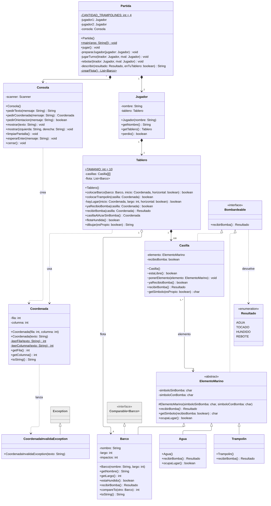
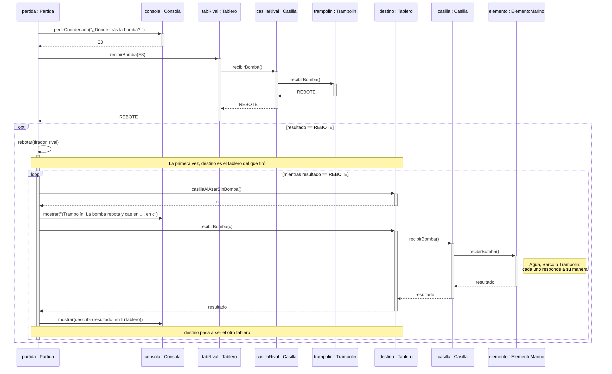

# Batalla Naval con Trampolines — Documento técnico

Paradigma Orientado a Objetos · UADE · 2.º cuatrimestre 2026 · Docente: Pablo Hernández

Grupo 5 (Chiqui Mafia): Santiago Terminiello, Nahuel Mioni, Emanuel Paoloni, Matias Llanos y Joaquin Valdettaro

Este documento explica el diseño del juego y señala dónde se aplica cada tema de la Sección 3 de la guía del TP. Las reglas para jugar están en el manual, en esta misma carpeta ([`Manual_Batalla_Naval_con_Trampolines.docx`](Manual_Batalla_Naval_con_Trampolines.docx)); acá se citan por su número.

- **Lenguaje:** Java, por consola. La Unidad 6 (archivo o Swing) y los hilos todavía están por definir con el docente: ver la [sección 8](#8-pendientes).
- **Tipos:** 13, uno por archivo `.java`, en el paquete por defecto: 11 clases, 1 interfaz y 1 enumerado.
- **Idea central:** cada casilla guarda un `ElementoMarino` (agua, barco o trampolín) y cada uno responde a la bomba a su manera. Así el tablero nunca tiene que preguntar qué hay en una casilla.

## Índice

1. [Estructura del repositorio](#1-estructura-del-repositorio)
2. [Diagrama de clases](#2-diagrama-de-clases)
3. [Responsabilidad de cada clase](#3-responsabilidad-de-cada-clase)
4. [Diagrama de secuencia: disparo con rebote en cadena](#4-diagrama-de-secuencia-disparo-con-rebote-en-cadena)
5. [Dónde se cumple cada regla del manual](#5-dónde-se-cumple-cada-regla-del-manual)
6. [Dónde se aplica cada tema de la guía](#6-dónde-se-aplica-cada-tema-de-la-guía)
7. [Patrones GRASP y principios SOLID](#7-patrones-grasp-y-principios-solid)
8. [Pendientes](#8-pendientes)

---

## 1. Estructura del repositorio

Todo el TPO va en la carpeta `TPO/`, separada de las carpetas de cada clase:

```text
paradigma-grupo5/
├── README.md
├── .gitignore
├── clase-02/ … clase-04/          ejercicios de cada clase
└── TPO/
    ├── DOCUMENTO_TECNICO.md       este documento
    ├── Manual_Batalla_Naval_con_Trampolines.docx
    ├── diagramas/
    │   ├── clases.mmd             fuente del diagrama de clases (Mermaid)
    │   ├── clases.png             el diagrama ya dibujado
    │   ├── secuencia_rebote.mmd
    │   └── secuencia_rebote.png
    └── src/                       se agrega cuando se empiece a programar
        ├── Partida.java           tiene el main
        ├── Consola.java
        ├── Jugador.java
        ├── Tablero.java
        ├── Casilla.java
        ├── Coordenada.java
        ├── Bombardeable.java
        ├── ElementoMarino.java
        ├── Agua.java
        ├── Barco.java
        ├── Trampolin.java
        ├── Resultado.java
        └── CoordenadaInvalidaException.java
```

**Compilar y ejecutar** desde la carpeta `TPO/`:

```bash
javac -encoding UTF-8 -d out src/*.java
java -cp out Partida
```

`-encoding UTF-8` evita problemas con las tildes y la ñ de los mensajes. Si en la consola de Windows las tildes se ven mal, ejecutar `chcp 65001` antes de `java`.

**Editar los diagramas.** Los `.mmd` son texto. Se pueden pegar en [mermaid.live](https://mermaid.live) para verlos y modificarlos; después hay que volver a exportar el `.png`.

---

## 2. Diagrama de clases



Fuente: [`diagramas/clases.mmd`](diagramas/clases.mmd).

### El diagrama en cuatro bloques

Conviene leerlo de arriba hacia abajo, en cuatro partes:

1. **El juego:** `Partida`, `Consola` y `Jugador`. La `Partida` dirige todo: tiene la consola y los dos jugadores. La `Consola` es la única que lee del teclado y escribe en pantalla.
2. **El tablero:** `Tablero`, `Casilla` y `Coordenada`. Cada jugador tiene un tablero de 100 casillas. Una `Coordenada` es la dirección de una casilla, como "B7".
3. **Lo que hay en el mar:** `Bombardeable`, `ElementoMarino`, `Agua`, `Barco`, `Trampolin` y `Resultado`. Cada casilla tiene un elemento, y cada elemento responde a la bomba a su manera.
4. **Apoyo:** `CoordenadaInvalidaException`, que avisa que lo escrito no es una casilla, y las cajas grises de Java.

El recorrido de una bomba atraviesa los bloques en orden: la `Partida` le pide al `Tablero` del rival que reciba la bomba en una `Coordenada`; el tablero se la pasa a esa `Casilla`; la casilla se la pasa a su elemento; y el elemento devuelve un `Resultado` (agua, tocado, hundido o rebote).

### Cómo leerlo

La notación es la de la clase 3: `visibilidad nombre: Tipo` para los atributos y `visibilidad operación(parámetros) : retorno` para los métodos.

| Símbolo | Significado |
| --- | --- |
| `+` `-` `#` `~` | public, private, protected, default (paquete) |
| Subrayado | `static` |
| Cursiva | abstracto |
| Rombo lleno | composición: la parte no existe sin el todo |
| Rombo vacío | agregación: la parte puede existir sin el todo |
| Triángulo y línea continua | herencia (`extends`) |
| Triángulo y línea punteada | implementación de una interfaz (`implements`) |
| Flecha punteada | dependencia: una clase usa, crea o lanza otra sin guardarla |
| Punta de flecha en una asociación, composición o agregación | navegabilidad: qué clase conoce a la otra |
| Cajas grises | clase e interfaz de Java que no programamos nosotros |

### Relaciones y por qué

| Relación | Tipo y multiplicidad | Por qué |
| --- | --- | --- |
| `Partida` → `Jugador` | Composición, 1 a 2 | La partida crea a los dos jugadores cuando se escriben los nombres y no existen fuera de ella. |
| `Partida` → `Consola` | Composición, 1 a 1 | La partida crea la consola en su constructor y la cierra al terminar. |
| `Jugador` → `Tablero` | Composición, 1 a 1 | Cada jugador crea su tablero en el constructor. |
| `Tablero` → `Casilla` | Composición, 1 a 100 | El tablero crea sus 10 x 10 casillas y ninguna casilla existe fuera de su tablero. |
| `Tablero` → `Barco` | Agregación, 1 a 4 (`flota`) | Los barcos los crea la `Partida` y se los pasa al tablero para colocarlos. El tablero los guarda en su flota para saber si se hundieron todos. |
| `Casilla` → `ElementoMarino` | Asociación, 1..* a 1 | Cada casilla tiene un solo elemento. Un mismo barco ocupa de 2 a 4 casillas, por eso del lado de la casilla es 1..*. |

---

## 3. Responsabilidad de cada clase

| Clase | Qué sabe y qué hace |
| --- | --- |
| `Partida` | Tiene el `main`. Controla el juego: pide los nombres, hace colocar las piezas, alterna los turnos, resuelve los rebotes y muestra al ganador. |
| `Consola` | Es la **única** clase que lee del teclado y escribe en pantalla. Vuelve a pedir los datos mal escritos. |
| `Jugador` | Sabe su nombre y tiene su tablero. Sabe si perdió. |
| `Tablero` | Tiene las 100 casillas y la flota. Coloca piezas, recibe bombas, elige casillas al azar para los rebotes, sabe si la flota está hundida y se dibuja como texto. |
| `Casilla` | Sabe qué elemento tiene y si ya recibió una bomba. Le pasa la bomba a su elemento. |
| `Coordenada` | Una fila y una columna. Traduce lo que escribe el jugador ("B7") a números y al revés. |
| `Bombardeable` | Interfaz: el contrato de todo lo que puede recibir una bomba. |
| `ElementoMarino` | Clase abstracta: cualquier cosa que puede haber en una casilla. Guarda los dos símbolos con que se dibuja. |
| `Agua`, `Barco`, `Trampolin` | Responden a la bomba cada uno a su manera (ver tabla abajo). `Barco` además cuenta sus impactos y sabe si está hundido. |
| `Resultado` | Enumerado: lo que puede pasar cuando cae una bomba. |
| `CoordenadaInvalidaException` | Excepción propia: el texto escrito no es una casilla. |

### 3.1 Los elementos del mar

Las tres subclases responden los mismos mensajes, cada una a su manera:

| | `Agua` | `Barco` | `Trampolin` |
| --- | --- | --- | --- |
| `recibirBomba()` | `AGUA` | Suma 1 a `impactos`. Devuelve `HUNDIDO` si llegó a `largo`, si no `TOCADO`. | `REBOTE` |
| Constructor | `super('~', 'O')` | `super('B', 'X')` | `super('T', 'R')` |
| `ocupaLugar()` | `false` (redefinido) | `true` (heredado) | `true` (heredado) |

`getSimbolo(recibioBomba)` está en `ElementoMarino`: devuelve el primer símbolo si la casilla no recibió bomba y el segundo si sí. Son los símbolos de la tabla "Qué se ve en la pantalla" del manual.

Un barco ocupa varias casillas, pero es **un solo objeto**: todas sus casillas apuntan al mismo `Barco`. Por eso, cuando `impactos` llega al largo, el barco sabe que está hundido.

`Barco` implementa `Comparable<Barco>`: el orden natural es de mayor a menor largo. La `Partida` ordena la flota con `Collections.sort` para que cada jugador coloque primero el acorazado, que es el más difícil de ubicar.

### 3.2 `Casilla`: el polimorfismo

```java
@Override
public Resultado recibirBomba() {
    recibioBomba = true;
    return elemento.recibirBomba();   // no pregunta qué tiene: cada elemento responde a su manera
}

char getSimbolo(boolean esPropio) {
    if (!esPropio && !recibioBomba) {
        return '~';                   // el rival no ve barcos ni trampolines escondidos
    }
    return elemento.getSimbolo(recibioBomba);
}
```

`Casilla` no tiene modificador de acceso (default): es un detalle interno del tablero y ninguna otra clase la usa.

### 3.3 `Coordenada`

Es **inmutable**: clase `final`, atributos `final` y sin setters. Tiene dos constructores:

```java
public Coordenada(int fila, int columna) { ... }          // fila y columna de 0 a 9

public Coordenada(String texto) throws CoordenadaInvalidaException {
    this(leerFila(texto), leerColumna(texto));             // llama al otro constructor
}
```

`leerFila` y `leerColumna` son `private static`. `leerColumna` usa `Integer.parseInt` y, si el texto no es un número, atrapa la `NumberFormatException` y lanza una `CoordenadaInvalidaException`.

| Texto | Resultado |
| --- | --- |
| `"B7"` | fila 1, columna 6 |
| `"j10"` | fila 9, columna 9 |
| `" e8 "` | fila 4, columna 7 (se ignoran espacios y mayúsculas) |
| `"K3"`, `"A0"`, `"A11"`, `"7B"`, `"hola"`, `""` | `CoordenadaInvalidaException` |

`toString()` devuelve la casilla como la escribe el jugador, por ejemplo `"E8"`.

### 3.4 `Tablero`

| Método | Qué hace |
| --- | --- |
| `Tablero()` | Crea la matriz `Casilla[10][10]`, la llena con `new Casilla()` y crea la `flota` vacía. |
| `colocarBarco(barco, inicio, horizontal)` | Si hay lugar, pone el mismo objeto `barco` en todas sus casillas, lo agrega a la flota y devuelve `true`. Si no, no cambia nada y devuelve `false`. Horizontal avanza hacia la derecha; vertical, hacia abajo. |
| `colocarTrampolin(casilla)` | Si la casilla está libre, pone un `new Trampolin()` y devuelve `true`. Si no, `false`. |
| `hayLugar(inicio, largo, horizontal)` | **Privado.** `true` si todas las casillas que ocuparía el barco están dentro del tablero (regla 4) y libres (regla 5). |
| `yaRecibioBomba(casilla)` | Le pregunta a esa casilla. |
| `recibirBomba(casilla)` | Le pasa la bomba a esa casilla y devuelve el resultado. |
| `casillaAlAzarSinBomba()` | Junta en una `List<Coordenada>` todas las casillas sin bomba y devuelve una al azar (regla 9). |
| `flotaHundida()` | `true` si todos los barcos de la flota están hundidos. |
| `dibujar(esPropio)` | El tablero como texto: una línea con los números de columna y una por fila, como en el ejemplo del manual. |

```java
public Coordenada casillaAlAzarSinBomba() {
    List<Coordenada> libres = new ArrayList<>();
    for (int fila = 0; fila < TAMANIO; fila++) {
        for (int columna = 0; columna < TAMANIO; columna++) {
            if (!casillas[fila][columna].yaRecibioBomba()) {
                libres.add(new Coordenada(fila, columna));
            }
        }
    }
    int posicion = (int) (Math.random() * libres.size());   // casteo de double a int
    return libres.get(posicion);
}
```

### 3.5 `Consola`

| Método | Qué hace |
| --- | --- |
| `pedirTexto(mensaje)` | Muestra el mensaje y lee una línea. Si está vacía, la vuelve a pedir. |
| `pedirCoordenada(mensaje)` | Pide texto hasta que `new Coordenada(texto)` no lance excepción. Si la lanza, muestra el mensaje de la excepción y vuelve a pedir. |
| `pedirOrientacion(mensaje)` | Pide H o V (acepta minúsculas). Devuelve `true` si es horizontal. |
| `mostrar(texto)` | Imprime un texto. |
| `mostrar(izquierda, derecha)` | **Sobrecarga.** Imprime dos textos de varias líneas uno al lado del otro: los dos tableros. |
| `limpiarPantalla()` | Imprime 50 líneas en blanco para que el otro jugador no vea nada. |
| `esperarEnter(mensaje)` | Muestra el mensaje y espera que se presione Enter. |
| `cerrar()` | Cierra el `Scanner`. |

```java
public Coordenada pedirCoordenada(String mensaje) {
    while (true) {
        String texto = pedirTexto(mensaje);
        try {
            return new Coordenada(texto);
        } catch (CoordenadaInvalidaException e) {
            mostrar(e.getMessage());          // "K3" no es una casilla. Escribí una letra...
        }
    }
}
```

### 3.6 `Partida`

| Método | Qué hace |
| --- | --- |
| `Partida()` | Crea la consola. |
| `main(args)` | **`static`.** Crea una partida y la juega. |
| `jugar()` | Pide los nombres, prepara a los dos jugadores, alterna turnos hasta que alguno pierda y muestra al ganador. Al final cierra la consola (ver 3.7). |
| `prepararJugador(jugador)` | Recorre la flota de `crearFlota()` y pide dónde va cada barco; después pide los 4 trampolines. Si una pieza no se puede colocar, avisa "No entra ahí o pisa otra pieza" y la vuelve a pedir. |
| `jugarTurno(tirador, rival)` | Muestra los dos tableros y pide la casilla. Si ya tenía bomba (`yaRecibioBomba`), pide otra sin perder el turno. Tira la bomba al rival; si el resultado es `REBOTE`, llama a `rebotar`. |
| `rebotar(tirador, rival)` | Resuelve el rebote y la cadena de rebotes (reglas 9 y 10). |
| `describir(resultado, enTuTablero)` | El mensaje de cada resultado (tabla abajo). |
| `crearFlota()` | **`static`.** Crea los 4 barcos en una `List<Barco>` y la ordena. |

```java
private void rebotar(Jugador tirador, Jugador rival) {
    Jugador destino = tirador;                     // el primer rebote cae en el tablero del que tiró
    Resultado resultado;
    do {
        boolean enTuTablero = (destino == tirador);
        Coordenada casilla = destino.getTablero().casillaAlAzarSinBomba();
        consola.mostrar("¡Trampolín! La bomba rebota y cae en "
                + (enTuTablero ? "TU tablero" : "el tablero de " + rival.getNombre().toUpperCase())
                + ", en una casilla al azar: " + casilla + ".");
        resultado = destino.getTablero().recibirBomba(casilla);
        consola.mostrar(describir(resultado, enTuTablero));
        destino = enTuTablero ? rival : tirador;   // si vuelve a rebotar, va al otro tablero
    } while (resultado == Resultado.REBOTE);
}
```

`destino == tirador` compara referencias a propósito: pregunta si es el mismo objeto, no si tienen el mismo nombre.

**La cadena siempre termina.** Cada rebote usa un trampolín, y un trampolín usado ya tiene bomba, así que no se vuelve a elegir. Como hay 8 trampolines en total, en un turno hay como mucho 8 rebotes. Además siempre hay casillas sin bomba para elegir: mientras ningún jugador perdió, cada tablero tiene al menos una parte de barco sana.

#### Mensajes de cada resultado

| Resultado | En el tablero del rival | En tu tablero |
| --- | --- | --- |
| `AGUA` | Agua. | Cayó al agua. Te salvaste. |
| `TOCADO` | ¡Tocado! | ¡Tocado! Le diste a un barco tuyo. |
| `HUNDIDO` | ¡Hundido! | ¡Hundido! Hundiste un barco tuyo. |
| `REBOTE` | Cayó en otro trampolín del rival. | Cayó en un trampolín tuyo. |

En un disparo normal, si el resultado es `REBOTE`, `jugarTurno` no usa la tabla: `rebotar` muestra la línea "¡Trampolín! La bomba rebota y cae en…", como en el ejemplo de pantalla del manual.

### 3.7 `main`, `jugar` y el cierre de la consola

```java
public static void main(String[] args) {
    Partida partida = new Partida();
    partida.jugar();
}

public void jugar() {
    try {
        // pedir nombres, preparar jugadores, alternar turnos y mostrar al ganador
    } catch (NoSuchElementException e) {          // se cerró la entrada del teclado (Ctrl+D / Ctrl+Z)
        consola.mostrar("Se cerró la entrada. Se termina el juego.");
    } finally {
        consola.cerrar();                         // se ejecuta siempre, termine bien o mal
    }
}
```

### 3.8 Excepciones

| Excepción | Quién la lanza | Quién la atrapa |
| --- | --- | --- |
| `CoordenadaInvalidaException` (propia, hereda de `Exception`) | `Coordenada(String)`, cuando el texto no es una casilla | `Consola.pedirCoordenada`, que muestra el mensaje y vuelve a pedir |
| `NumberFormatException` (de Java) | `Integer.parseInt` en `Coordenada.leerColumna` | La misma `leerColumna`, que la cambia por una `CoordenadaInvalidaException` |
| `NoSuchElementException` (de Java) | El `Scanner` de la `Consola`, si se cierra la entrada del teclado | `Partida.jugar`, que termina el juego y cierra la consola en el `finally` |
| `IllegalArgumentException` (de Java) | `Coordenada(int, int)` fuera del tablero, `Barco(...)` con largo menor que 1 | Nadie: indica un error de programación, no del jugador |

`CoordenadaInvalidaException` es **comprobada** (checked) porque hereda de `Exception`: el compilador obliga a declararla con `throws` y a atraparla. Pasa su mensaje con `super(mensaje)` y la consola lo muestra con `e.getMessage()`.

---

## 4. Diagrama de secuencia: disparo con rebote en cadena

El escenario: el tirador tira a E8, donde el rival tiene un trampolín. La bomba rebota a una casilla al azar del tablero del tirador. Si ahí hay otro trampolín, vuelve a rebotar al tablero del rival, y así hasta que caiga en algo que no sea un trampolín.



Fuente: [`diagramas/secuencia_rebote.mmd`](diagramas/secuencia_rebote.mmd).

- El fragmento **opt** solo se ejecuta si el disparo cayó en un trampolín.
- El fragmento **loop** es la cadena de rebotes: se repite mientras el resultado sea `REBOTE`.
- En `elemento.recibirBomba()` se ve el polimorfismo: la casilla no sabe si tiene agua, un barco o un trampolín, y cada uno devuelve su resultado.
- Antes de tirar, `jugarTurno` controla con `yaRecibioBomba(E8)` que no se haya tirado ahí antes.

---

## 5. Dónde se cumple cada regla del manual

| Regla | Qué dice | Dónde se cumple |
| --- | --- | --- |
| 1 | Tablero de 10 x 10 | `Tablero.TAMANIO` y el constructor de `Tablero` |
| 2 | 4 barcos y 4 trampolines | `Partida.crearFlota` y `Partida.CANTIDAD_TRAMPOLINES` en `prepararJugador` |
| 3 | Horizontal o vertical | `Consola.pedirOrientacion` y el parámetro `horizontal` de `Tablero.colocarBarco` |
| 4 | El barco entra completo | `Tablero.hayLugar` |
| 5 | No se superponen piezas (pegadas sí) | `Casilla.estaLibre`, usado en `hayLugar` y `colocarTrampolin`. No se revisan las casillas vecinas. |
| 6 | Turnos alternados, una bomba por turno | El `while` de `Partida.jugar` |
| 7 | No repetir casilla sin perder el turno | `Partida.jugarTurno` con `Tablero.yaRecibioBomba` |
| 8 | Agua, tocado, hundido o trampolín | `Resultado` y `recibirBomba()` de `Agua`, `Barco` y `Trampolin` |
| 9 | El rebote cae en una casilla al azar sin bombas del que tiró | `Tablero.casillaAlAzarSinBomba` y `Partida.rebotar` |
| 10 | Qué pasa en el rebote, y la cadena | El `do-while` de `Partida.rebotar`, que alterna el tablero de destino |
| 11 | Cada trampolín funciona una vez y queda con R | `Casilla.recibioBomba` queda en `true`: no se puede volver a tirar ahí ni se elige al azar. `Trampolin` se dibuja `R`. |
| 12 | Avisar dónde cayó cada rebote y qué pasó | Los dos mensajes de cada vuelta de `Partida.rebotar` |
| 13 | Pierde el que se queda sin barcos | `Jugador.perdio` → `Tablero.flotaHundida` |
| 14 | Se puede perder con tu propio rebote | `Partida.jugar` revisa a los dos jugadores después de cada turno |

---

## 6. Dónde se aplica cada tema de la guía

### Unidad 1 — Introducción a la POO y UML

| Tema | Dónde |
| --- | --- |
| Diagrama de clases del sistema completo | [Sección 2](#2-diagrama-de-clases) |
| Diagrama de secuencia de un caso de uso | [Sección 4](#4-diagrama-de-secuencia-disparo-con-rebote-en-cadena): disparo con rebote en cadena |
| Clases, objetos, atributos, métodos | Las 11 clases. Objetos: dos `Jugador`, dos `Tablero`, 200 `Casilla`, 8 `Barco`, 8 `Trampolin` por partida. |
| Relaciones: cardinalidad, direccionalidad, composición | Tabla de relaciones de la sección 2. Las flechas marcan la navegabilidad. |
| Constructores | Todas las clases. Con parámetros en `Barco`, `Coordenada`, `Jugador`, `ElementoMarino` y la excepción. |
| Destructores | Java no tiene destructores: el recolector de basura libera los objetos que ya no se usan. Lo que sí hay que cerrar a mano es el `Scanner`: `Partida.jugar` llama a `consola.cerrar()` en el `finally`. |
| Primitivos | `int` (`fila`, `columna`, `largo`, `impactos`), `char` (símbolos), `boolean` (`recibioBomba`, `horizontal`) |
| Wrappers | `Integer.parseInt` en `Coordenada.leerColumna`, `Integer.compare` en `Barco.compareTo`, `Character.toUpperCase` en `Coordenada.leerFila` |

### Unidad 2 — Funcionamiento del lenguaje OO

| Tema | Dónde |
| --- | --- |
| Estructura básica, sintaxis, buenas prácticas | Una clase por archivo, `Partida.main` como punto de entrada, atributos privados, clases en PascalCase, métodos y variables en camelCase, constantes en MAYÚSCULAS. |
| Tipos primitivos y de referencia | Los atributos de la Unidad 1. Varias casillas guardan una referencia al mismo `Barco`. En `rebotar`, `destino == tirador` compara referencias a propósito. |
| Casteo | `(char) ('A' + fila)` en `Coordenada.toString` y `Tablero.dibujar`. `(int) (Math.random() * libres.size())` en `casillaAlAzarSinBomba`. `letra - 'A'` en `leerFila` pasa de `char` a `int` sin casteo explícito (promoción). |
| Arreglos | `Casilla[][] casillas` en `Tablero`: bidimensional, de referencias. `String[]` en `Consola.mostrar(izquierda, derecha)` (resultado de `split`) y en `main`. |

### Unidad 3 — Clases y Objetos

| Tema | Dónde |
| --- | --- |
| Herencia | `Agua`, `Barco` y `Trampolin` heredan de `ElementoMarino`. `CoordenadaInvalidaException` hereda de `Exception`. |
| Sobrecarga de métodos | `Consola.mostrar(String)` y `Consola.mostrar(String, String)` |
| Sobreescritura de métodos | `recibirBomba()` en las tres subclases, `ocupaLugar()` en `Agua`, `toString()` en `Coordenada` y `Barco`, `compareTo()` en `Barco`. Todas con `@Override`. |
| Sobrecarga de constructores | `Coordenada(int, int)` y `Coordenada(String)` |
| `public` | Las clases (salvo `Casilla`) y casi todos los métodos |
| `private` | Todos los atributos, y métodos auxiliares como `hayLugar`, `leerFila` y los de `Partida` |
| `protected` | El constructor de `ElementoMarino`: solo lo llaman sus subclases |
| default | La clase `Casilla` y sus métodos (salvo `recibirBomba`, que es público porque viene de la interfaz) |
| Clase abstracta | `ElementoMarino`, con `recibirBomba()` abstracto. No se crean objetos de esta clase. |
| Interfaz y su contrato | `Bombardeable`: "recibir una bomba y decir qué pasó". La cumplen `Casilla` y `ElementoMarino` (y por herencia sus subclases). Además `Barco` implementa `Comparable<Barco>` de Java. |
| Polimorfismo | `Casilla.recibirBomba()` llama a `elemento.recibirBomba()` sin saber qué tiene. No hay ningún `if` ni `instanceof` para distinguir agua, barco o trampolín. |
| `super()` | `Agua()`, `Barco(...)` y `Trampolin()` llaman a `super(simboloSinBomba, simboloConBomba)`. La excepción llama a `super(mensaje)`. |
| `this()` | `Coordenada(String)` llama a `this(leerFila(texto), leerColumna(texto))`. Además, `this.atributo = parámetro` en los constructores. |
| `static` | `Tablero.TAMANIO`, `Partida.CANTIDAD_TRAMPOLINES`, `Partida.main()`, `Partida.crearFlota()`, `Coordenada.leerFila()` y `leerColumna()` |
| GRASP y SOLID | [Sección 7](#7-patrones-grasp-y-principios-solid) |
| Opcional: clase inmutable | `Coordenada` |
| Opcional: enumerados | `Resultado` |
| Opcional: clases internas | No se usan. |

### Unidad 4 — Colecciones

| Tema | Dónde |
| --- | --- |
| Colecciones genéricas | `List<Barco> flota` (`ArrayList`) en `Tablero`. `List<Barco>` en `Partida.crearFlota`. `List<Coordenada>` en `Tablero.casillaAlAzarSinBomba`. |
| Ordenamiento natural (`Comparable`) | `Barco implements Comparable<Barco>`: de mayor a menor largo. `Collections.sort` en `Partida.crearFlota`. |
| Ordenamiento personalizado (`Comparator`) | No hace falta para el juego. Si se hace el historial de partidas, se usa ahí (sección 8). |
| Recorrido con cursores (for-each) | `for (Barco barco : flota)` en `Tablero.flotaHundida` y en `Partida.prepararJugador` |

### Unidad 5 — Manejo de excepciones

| Tema | Dónde |
| --- | --- |
| `try` / `catch` | `Consola.pedirCoordenada`, `Coordenada.leerColumna` y `Partida.jugar` |
| `finally` | `Partida.jugar`: cierra la consola siempre |
| `throw` | `Coordenada` lanza `CoordenadaInvalidaException`. `Coordenada(int, int)` y `Barco(...)` lanzan `IllegalArgumentException` si reciben valores inválidos. |
| `throws` | `Coordenada(String)`, `leerFila` y `leerColumna` |
| Excepción propia | `CoordenadaInvalidaException` (sección 3.8) |
| Excepciones comunes | `NumberFormatException` en `Coordenada.leerColumna`. `NoSuchElementException` del `Scanner` en `Partida.jugar`. |

### Unidad 6 — Entrada/Salida: Swing, archivos e hilos

Pendiente: ver la [sección 8](#8-pendientes).

---

## 7. Patrones GRASP y principios SOLID

### GRASP

| Patrón | Dónde | Por qué |
| --- | --- | --- |
| **Experto en información** | `Barco.estaHundido()`, `Tablero.flotaHundida()`, `Tablero.casillaAlAzarSinBomba()` | Cada responsabilidad está en la clase que tiene los datos: el barco tiene su largo y sus impactos; el tablero tiene las casillas y la flota. |
| **Polimorfismo** | `ElementoMarino` y sus subclases | El comportamiento que cambia según el tipo (qué pasa con la bomba, cómo se dibuja) está en cada subclase, en lugar de un `if` que pregunte qué hay en la casilla. |
| Creador | `Tablero` crea sus `Casilla`, `Jugador` crea su `Tablero`, `Partida` crea los `Jugador` y la `Consola` | Cada clase crea los objetos que contiene (composición). |
| Controlador | `Partida` | Recibe lo que escribe el jugador a través de la consola y coordina el caso de uso "jugar un turno", sin manejar casillas ella misma. |
| Alta cohesión y bajo acoplamiento | `Consola` | Toda la entrada y salida está en una sola clase. `Partida` no conoce a `Casilla`, solo a `Tablero`. |

### SOLID

| Principio | Dónde | Por qué |
| --- | --- | --- |
| **S** — Responsabilidad única | `Consola`, `Coordenada`, `Tablero` | Cada una tiene un solo motivo para cambiar: `Consola` cambia si cambia la pantalla, `Coordenada` si cambia cómo se escriben las casillas, `Tablero` si cambian las reglas del tablero. |
| **O** — Abierto/cerrado | `ElementoMarino` | Para agregar un elemento nuevo (por ejemplo, una mina) alcanza con una subclase nueva. `Casilla` y `Tablero` no se tocan. |
| L — Sustitución de Liskov | `Agua`, `Barco`, `Trampolin` | Cualquiera puede estar en una casilla donde se espera un `ElementoMarino`, y la casilla funciona igual. |
| I — Segregación de interfaces | `Bombardeable` | Tiene una sola operación: quien la implementa no carga métodos que no usa. |
| D — Inversión de dependencias | `Casilla` | Depende de la abstracción `ElementoMarino`, no de `Barco` ni de `Trampolin`. |

Para la defensa, los más claros son **Experto en información** y **Polimorfismo** (GRASP), y **Responsabilidad única** y **Abierto/cerrado** (SOLID).

---

## 8. Pendientes

Estas decisiones son del grupo y del docente. Hasta que se definan, no están en el diagrama de clases.

### Unidad 6: archivo o interfaz Swing

La guía pide un archivo **o** una interfaz gráfica con eventos, según lo que se acuerde con el docente. Todavía no se habló con él.

- **Si es archivo:** el grupo eligió guardar un **historial de partidas** (fecha, ganador y cantidad de turnos de cada partida). Eso agregaría una clase que escriba y lea el archivo, una clase para cada partida registrada y un contador de turnos en `Partida`. Además ahí entraría el `Comparator`, para mostrar el historial ordenado.
- **Si es Swing:** cambian la `Consola` y el manual, porque el juego deja de ser por consola.

### Hilos de ejecución

La guía pide definir y crear al menos un hilo aparte. Todavía no se definió para qué. Algunas opciones posibles: un tiempo límite por turno, una animación del rebote o, si se usa archivo, guardarlo en segundo plano.

### Para revisar en el grupo

- **Orden de colocación:** con el `Comparable` de `Barco`, el juego pide primero el acorazado y al final las lanchas. El manual no dice en qué orden se colocan, así que no lo contradice.
- **Mensajes:** los textos de la tabla de la sección 3.6 son una propuesta. El ejemplo de pantalla del manual ya los usa.
