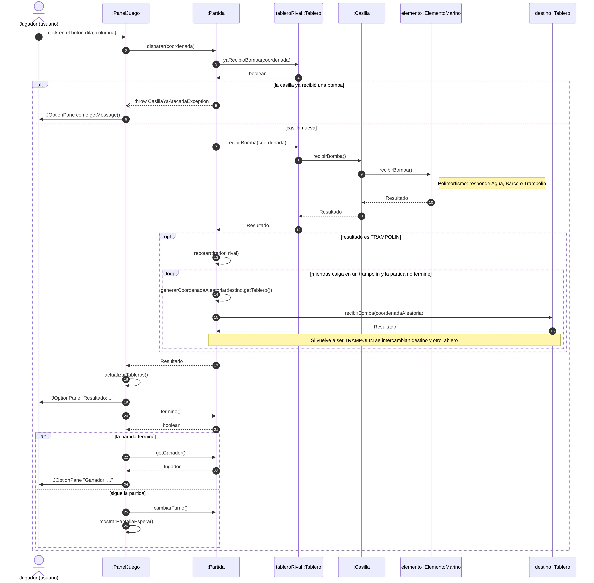
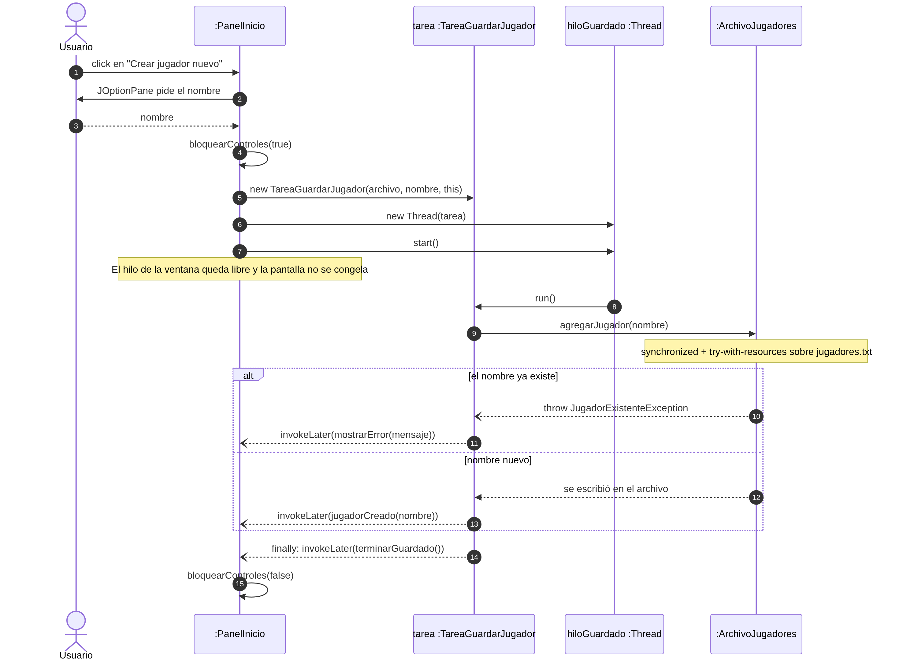

# Documentación técnica – Batalla Naval con Trampolines

Paradigma Orientado a Objetos · UADE · 2.º cuatrimestre 2026 · Grupo 5

## 1. Introducción

Batalla Naval con Trampolines es un juego para dos jugadores en la misma computadora, hecho en Java con interfaz gráfica Swing. Cada jugador coloca en un tablero de 10 x 10 cuatro barcos (dos Lanchas de largo 2, una Fragata de 3 y un Acorazado de 4) y cuatro trampolines.

Por turnos, cada jugador dispara al tablero rival. Si la bomba cae en un trampolín, rebota a una casilla al azar, sin bomba, del tablero de quien disparó; si ahí hay otro trampolín, vuelve a rebotar al otro tablero. Gana quien hunde primero toda la flota rival.

**Ejecución:** abrir la carpeta del proyecto en el IDE y ejecutar `TPO/BATALLA_NAVAL/Main.java` (JDK 8 o superior). Al iniciar se eligen dos jugadores guardados o se crean nuevos; los nombres quedan en `jugadores.txt`, en la carpeta desde la que se ejecuta el juego.

## 2. Diseño general

El código separa la lógica del juego (modelo) de las pantallas (vista). Las pantallas nunca deciden reglas: le preguntan a `Partida` y a `Tablero` qué pasó, de quién es el turno y si terminó la partida, y solo muestran la respuesta.

| Paquete | Contenido | Rol |
| --- | --- | --- |
| `CLASES` | `Partida`, `Jugador`, `Tablero`, `Casilla`, `Coordenada`, `Resultado`, `ArchivoJugadores` y las excepciones propias | Reglas del juego y persistencia |
| `CLASES.ELEMENTOS_MARINOS` | `ElementoMarino` y sus hijas `Agua`, `Barco`, `Trampolin` | Lo que puede haber en una casilla |
| `TDAs` | `FlotaInterfaz` y `FlotaImp` | TDA Flota: los barcos de un jugador |
| `INTERFAZ` | `VentanaPrincipal`, `PanelInicio`, `PanelPreparacion`, `PanelJuego` y los dos hilos | Pantallas Swing y tareas en segundo plano |

Hay una sola ventana (`VentanaPrincipal`, que hereda de `JFrame`). Lo que cambia es el panel que muestra, en este orden:

1. `PanelInicio`: elegir o crear los dos jugadores.
2. `PanelPreparacion`: cada jugador coloca sus barcos y trampolines, con una pantalla de espera entre uno y otro.
3. `PanelJuego`: turnos de disparo, con una pantalla de espera entre turnos para que el rival no vea el tablero ajeno.
4. Al terminar, `PanelJuego` muestra el ganador y un botón que vuelve a `PanelInicio` (`VentanaPrincipal.volverAlInicio()`).

## 3. Clases y responsabilidades

Cada clase tiene una responsabilidad clara; las del modelo no conocen a las pantallas.

| Clase | Responsabilidad |
| --- | --- |
| `Partida` | Reglas: turno actual, disparo, rebote en trampolines, fin de la partida y ganador |
| `Jugador` | Nombre y tablero de cada jugador; sabe si perdió |
| `Tablero` | Matriz de 10 x 10 casillas y la flota; coloca barcos y trampolines, recibe bombas y se dibuja como texto |
| `Casilla` | Guarda un elemento y si ya recibió una bomba; le delega la bomba al elemento |
| `ElementoMarino` | Clase abstracta: define `recibirBomba()` y `getSimbolo()` |
| `Agua`, `Barco`, `Trampolin` | Cada una responde a la bomba a su manera (agua, tocado/hundido, rebote) |
| `Coordenada` | Fila y columna de una casilla; se muestra como "B5" |
| `Resultado` | Respuesta de un disparo: agua, tocado, hundido o trampolín |
| `FlotaInterfaz` / `FlotaImp` | TDA Flota: agrega barcos, controla el máximo de 4 y sabe si está hundida |
| `ArchivoJugadores` | Lee y escribe `jugadores.txt` |
| `CasillaYaAtacadaException`, `JugadorExistenteException` | Excepciones propias del juego |
| `VentanaPrincipal` | Ventana única; cambia de pantalla |
| `PanelInicio` | Menú: elegir y crear jugadores |
| `PanelPreparacion` | Colocar barcos y trampolines |
| `PanelJuego` | Turnos de disparo, resultado y final de la partida |
| `HiloCargaJugadores`, `TareaGuardarJugador` | Leer y guardar jugadores en un hilo aparte |

`Consola` queda de la primera versión por consola y no la usa ninguna clase.

## 4. Dónde se aplica cada concepto

La tabla indica la clase y el método donde aparece cada concepto de la materia.

| Concepto | Dónde se aplica |
| --- | --- |
| Clases y objetos | Los objetos se crean con `new`: `PanelInicio.comenzarPartida()` crea los dos `Jugador`, y cada `Jugador` crea su `Tablero` |
| Encapsulamiento | Todos los atributos son `private` y se leen con getters (`Jugador.getNombre()`, `Coordenada.getFila()`, `Resultado.getTipo()`) |
| Constructores y sobrecarga de constructores | `Coordenada(int, int)` y `Coordenada(char, int)`, que llama al primero con `this(...)`; `ArchivoJugadores()` llama a `this(ARCHIVO_POR_DEFECTO)` |
| Sobrecarga de métodos | `Partida.disparar(Coordenada)` y `Partida.disparar(int, int)` |
| Herencia | `Agua`, `Barco` y `Trampolin` heredan de `ElementoMarino`; los paneles heredan de `JPanel`, `VentanaPrincipal` de `JFrame` y las excepciones propias de `Exception` |
| Clase abstracta | `ElementoMarino`: constructor `protected` y métodos abstractos `recibirBomba()` y `getSimbolo()` |
| Sobreescritura (`@Override`) | `recibirBomba()` y `getSimbolo()` en cada elemento; `toString()` en `Resultado` y `Coordenada`; `compareTo()` en `Barco`; `run()` en los hilos |
| Polimorfismo | `Casilla.recibirBomba()` y `Casilla.getSimbolo()` llaman al método del elemento sin saber si es agua, barco o trampolín |
| Interfaces | `FlotaInterfaz` (implementada por `FlotaImp`), `Comparable<Barco>` (en `Barco`) y `Runnable` (en `TareaGuardarJugador`) |
| TDA | Flota: `FlotaInterfaz` es el contrato y `FlotaImp` la implementación con un `ArrayList<Barco>` |
| Relaciones entre clases | Composición: `Jugador` tiene un `Tablero`, y `Tablero` tiene sus `Casilla` y su `FlotaImp`. Agregación: `Partida` usa dos `Jugador` que vienen de afuera |
| Miembros `static` y constantes | `Tablero.TAMANIO`, `Resultado.AGUA` / `TOCADO` / `HUNDIDO` / `TRAMPOLIN`, `ArchivoJugadores.ARCHIVO_POR_DEFECTO`, `Coordenada.desdeTexto()`, `Main.main()` |
| Modificadores de acceso | `private` en atributos; `public` en lo que usan otras clases; `protected` en el constructor de `ElementoMarino`; default en la clase `Main` y en los métodos de `PanelInicio` que llaman los hilos |
| Arrays y matrices | `Casilla[10][10]` en `Tablero`; `JButton[10][10]` en los paneles; arrays `nombresBarcos` y `largosBarcos` en `PanelPreparacion` |
| Colecciones y genéricos | `ArrayList<Barco>` en `FlotaImp`; `ArrayList<String>` en `ArchivoJugadores`; `JComboBox<String>` en `PanelInicio` |
| Ordenamiento | `Barco.compareTo()` ordena por largo; `FlotaImp.getBarcosOrdenados()` usa `Collections.sort` |
| Estructuras de control | `for` anidados en `Tablero`; `while` en `Partida.rebotar()` y en `ArchivoJugadores.leerJugadores()`; `do-while` en `Partida.generarCoordenadaAleatoria()`; `switch` en `Resultado.toString()` |
| Excepciones | Propias (checked): `CasillaYaAtacadaException` y `JugadorExistenteException`. De Java: `IllegalArgumentException` (`Barco`), `IllegalStateException` (`FlotaImp`, `Partida.getGanador()`), `IOException` (archivo). Se usan `throw`, `throws`, `try` / `catch` / `finally` |
| Archivos | `ArchivoJugadores`: lectura y escritura de `jugadores.txt` con try-with-resources |
| Hilos | `HiloCargaJugadores` (hereda de `Thread`) y `TareaGuardarJugador` (implementa `Runnable`); `SwingUtilities.invokeLater`; métodos `synchronized` en `ArchivoJugadores` |
| Interfaz gráfica | Swing: `JFrame`, `JPanel`, `BorderLayout`, `GridLayout`, `GridBagLayout`, botones con eventos escritos como lambdas |
| GRASP – Polimorfismo | `ElementoMarino` y sus hijas, usadas en `Casilla.recibirBomba()` (marcado con un comentario en el código) |
| SOLID – Responsabilidad única | `ArchivoJugadores` solo maneja el archivo: la ventana no sabe nada del archivo, y el archivo no sabe nada de la ventana |

## 5. Archivos, excepciones e hilos

**Archivo.** `ArchivoJugadores` guarda un nombre por línea en `jugadores.txt` (UTF-8). `leerJugadores()` devuelve la lista, o una lista vacía si el archivo todavía no existe. `agregarJugador()` escribe al final del archivo y lanza `JugadorExistenteException` si el nombre ya estaba, sin importar mayúsculas.

**Destructores.** Java no tiene destructores: la memoria la libera el recolector de basura cuando un objeto queda sin referencias (por ejemplo, el panel anterior al cambiar de pantalla). Los recursos externos sí se cierran, con try-with-resources: el lector y el escritor del archivo se cierran solos aunque ocurra una excepción.

**Excepciones.** `Partida.disparar()` lanza `CasillaYaAtacadaException` si se repite una casilla; `PanelJuego.disparar()` la atrapa, muestra el mensaje y no se pierde el turno. `JugadorExistenteException` e `IOException` se atrapan en los hilos, que le piden a la pantalla que muestre el error.

**Hilos.** Swing dibuja y atiende los clics en un único hilo; si ese hilo esperara al disco, la ventana se congelaría. Por eso el archivo se usa en hilos aparte, iniciados con `start()`:

| Clase | Forma | Cuándo |
| --- | --- | --- |
| `HiloCargaJugadores` | Hereda de `Thread` | Al abrir el menú, lee los jugadores guardados |
| `TareaGuardarJugador` | Implementa `Runnable` y se pasa a `new Thread(...)` | Al crear un jugador, lo guarda |

Los hilos no tocan la ventana directamente: usan `SwingUtilities.invokeLater`. Su `finally` vuelve a habilitar los botones pase lo que pase, y los métodos `synchronized` de `ArchivoJugadores` evitan que dos hilos escriban a la vez.

## 6. Diagramas UML

Se entregan un diagrama de clases y dos diagramas de secuencia, en la carpeta [`diagramas`](diagramas).

| Diagrama | Archivo | Qué muestra |
| --- | --- | --- |
| Clases | [`diagrama_clases_entrega.drawio`](diagramas/diagrama_clases_entrega.drawio) | Paquetes `CLASES`, `ELEMENTOS_MARINOS` e `INTERFAZ` con atributos, métodos y relaciones. Para que se lea mejor no incluye el TDA Flota ni los hilos, que se explican en las secciones 3 a 5 |
| Secuencia: disparo | [`secuencia_disparo.png`](diagramas/secuencia_disparo.png) | Un disparo desde el clic hasta el resultado: la excepción por casilla repetida, el polimorfismo de `recibirBomba()` y la cadena de rebotes |
| Secuencia: crear jugador | [`secuencia_crear_jugador.png`](diagramas/secuencia_crear_jugador.png) | El guardado de un jugador nuevo en un hilo aparte y la vuelta a la pantalla con `invokeLater` |

**Notación del diagrama de clases:** `+` público, `-` privado, `#` protegido, `~` default; subrayado = `static`; cursiva = abstracto. Triángulo vacío = herencia (punteado si es una interfaz); rombo lleno = composición; rombo vacío = agregación; flecha simple = asociación; flecha punteada = dependencia (`«create»`, `«use»`, `«throws»`).

### Secuencia: disparo

### Secuencia: crear jugador

